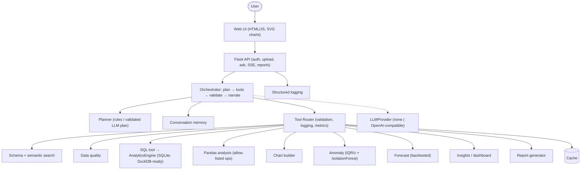
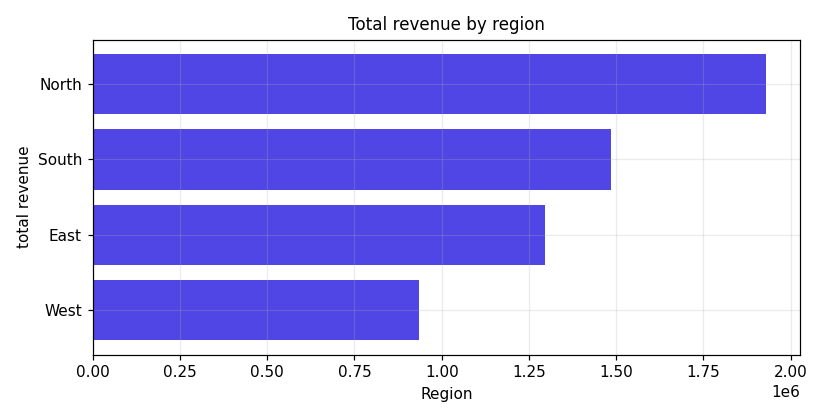
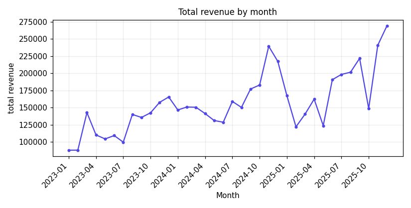
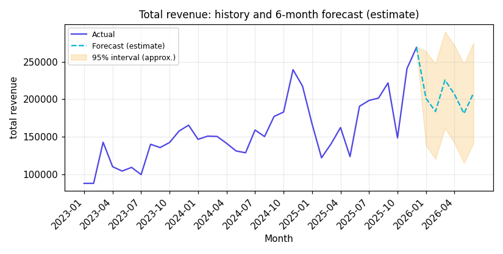
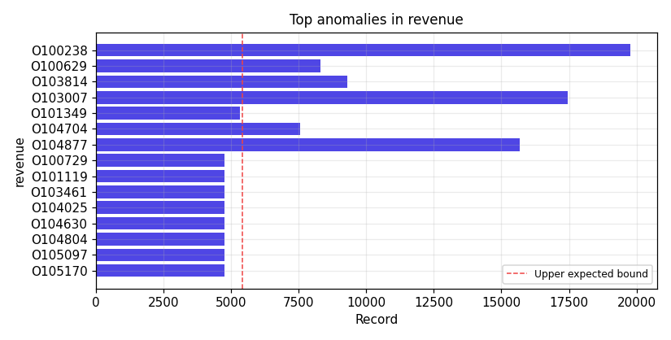

# AI Data Analyst

Upload one or more CSV files and interact with them in natural language: ask questions, get insights, charts, SQL / pandas
code, anomaly explanations and forecasts – with every number computed by deterministic tools (SQL, pandas, SciPy,
scikit-learn), never invented by an LLM.

> **Verification status (honest summary)**
> ✅ 91 automated tests pass · ✅ 26/26 evaluation questions pass · ✅ 10/10 manual QA scenarios pass against a live server
> ⚠️ **Docker files are written but were never built or run** (no Docker in the build sandbox)
> ⚠️ **The web UI was not opened in a real browser** (none available): the JS was syntax-checked and its chart/result renderers were executed in Node against real output, which proves they run – not that they look right
> ⚠️ **No real LLM API was reachable**: the LLM path is tested only against a local stub server. The default engine is fully deterministic and needs no key
> ⬜ UI screenshots and the demo video must be produced by you (see `docs/SUBMISSION_CHECKLIST.md`)

## Overview

The app is a plan-and-execute analytics agent. A question is classified into an intent, turned into a small validated
plan (metric, dimension, filters, time grain), executed through modular **tools**, validated (e.g. grouped totals are
reconciled with an independent total), and narrated from the computed facts. An LLM can optionally refine the plan and
phrase the answer, but its output is schema-validated and number-checked.

## Features

| Area | What is implemented |
|---|---|
| Ingestion | multi-file upload; extension/size/binary/empty checks; UTF-8 → Windows-1252 fallback; delimiter sniffing; missing / duplicate headers; ragged rows skipped & reported; currency/number/date/boolean inference; invalid values counted, not hidden |
| Profiling | per-column type, role (measure/dimension/date/id/text), missing %, unique count, numeric stats, date ranges, top values |
| Data quality | missing, duplicates, constant/empty columns, high cardinality, type inconsistencies, extreme outliers, identifier columns; 0–100 score with documented weights; severity, affected rows, recommendation |
| Multi-file | automatic join detection (name match + value containment + key uniqueness); automatic `LEFT JOIN` chains in generated SQL |
| NL analysis | 12 intents (ranking, aggregation, comparison, trend, drivers, anomaly, forecast, quality, insights, distribution/scatter, schema, SQL recall); metric/dimension/entity resolution with business-term synonyms; year filters; top-N; “underperforming” |
| Code | SQL for every analysis (Copy button) + an equivalent pandas snippet (verified equal to the SQL result in tests) |
| Charts | bar, horizontal bar (rankings), line (time), pie/donut, scatter, histogram, KPI – custom SVG renderer (no external library), built only from result frames |
| Dashboard | KPI cards (revenue, orders, AOV, unique customers, growth, quality), trend / category / region charts, anomaly + quality cards; updates after upload |
| Anomalies | IQR (k=3) or z-score chosen automatically from winsorised skewness + Isolation Forest; each flag has row/ID, actual, expected range, score, reason |
| Forecasting | moving average, linear, Holt, seasonal additive/multiplicative; model chosen by backtest MAE; approximate 95% bands; labelled as estimates |
| “Why did X fall?” | month-over-month driver analysis by every available category (+ customer/product) |
| Memory | structured per-conversation state; “its / that / what about South” resolved; stale filters not inherited by fully-specified questions |
| Semantic search | TF-IDF char n-grams + business synonyms over metadata only (no raw values embedded) |
| Caching | TTL/LRU cache keyed by dataset fingerprint + normalised query; stats in Settings |
| Streaming | real Server-Sent Events: one status event per executed pipeline step (LLM *token* streaming is not implemented) |
| Auth | register / login / logout; scrypt hashes; HttpOnly SameSite cookies; login throttling; CSRF header; per-user data isolation |
| Reports | Markdown, HTML (charts embedded as PNG), CSV for any answer; whole-session Markdown/HTML |
| Observability | JSON logs with request ID, user, tool, durations, SQL time, cache hit, LLM latency/tokens, dataset fingerprint; secrets redacted; `/api/metrics` |
| Evaluation | 26-question harness scoring intent / tools / chart / numeric / SQL / relevance against independent pandas truth |

## Architecture



Full diagrams and design decisions: [`docs/architecture.md`](docs/architecture.md).

## Tech stack

Python 3.12 · Flask · pandas · NumPy · SciPy · scikit-learn · SQLite (analytics + app DB) · matplotlib (report PNGs) ·
vanilla HTML/CSS/JS with a custom SVG chart renderer · `unittest` · Docker (unverified).

**Why not FastAPI / DuckDB / React / pytest?** The build environment had no network, so only preinstalled packages could be
used. The code is structured so they can be introduced later: `AnalyticsEngine` (SQL engine), `LLMProvider`, and a thin
Flask blueprint. Tests are plain `unittest` (also collected by `pytest` if you have it).

## Screenshots

Real chart renders produced by the server-side renderer from real analysis results
(these are **not** screenshots of the web UI — add UI screenshots from your own browser, see the checklist):

| | |
|---|---|
|  |  |
|  |  |

## Demo

Demo video: *not included* – record it with [`docs/DEMO_SCRIPT.md`](docs/DEMO_SCRIPT.md) (10–30 s) and link it here.
Evidence of behaviour is in [`docs/QA_REPORT.md`](docs/QA_REPORT.md) and `docs/sample_exports/`.

## Installation & local development

```bash
python -m venv .venv && source .venv/bin/activate
pip install -r requirements.txt
cp .env.example .env            # optional – defaults work
python scripts/generate_samples.py   # optional – sample CSVs are already committed
python run.py                   # http://127.0.0.1:5000
```
Register an account, click **Load sample datasets** (or upload `data/samples/*.csv`), then open **Analysis**.

## Docker

```bash
echo "SECRET_KEY=$(python -c 'import secrets;print(secrets.token_hex(32))')" > .env
docker compose up --build        # http://localhost:5000
```
⚠️ **Not tested**: Docker is unavailable in the environment where this project was built. The Dockerfile uses a single
gunicorn worker (datasets live in per-process memory) and keeps the sample CSVs outside the data volume.

## Environment variables

| Variable | Default | Purpose |
|---|---|---|
| `APP_ENV` | `development` | `production` requires `SECRET_KEY` and sets Secure cookies |
| `SECRET_KEY` | generated & stored in `data/.secret_key` (dev only) | session signing |
| `MAX_UPLOAD_SIZE_MB` | `50` | per-file upload limit |
| `MAX_ROWS` | `2000000` | row limit per file |
| `CACHE_ENABLED` / `CACHE_TTL_SECONDS` | `true` / `900` | result cache |
| `CURRENCY_SYMBOL` | `₹` | shown for money-like columns (name contains revenue/sales/amount/price/…) |
| `REGISTRATION_OPEN` | `true` | disable public sign-up |
| `DATA_DIR` / `LOG_DIR` / `SAMPLES_DIR` | `./data` / `./logs` / `./data/samples` | storage locations |
| `LLM_PROVIDER` | `none` | `none` or `openai` (any OpenAI-compatible `/chat/completions`) |
| `LLM_API_KEY`, `LLM_BASE_URL`, `LLM_MODEL`, `LLM_TIMEOUT_SECONDS` | – | LLM connection (never logged) |

## Usage & example questions

* Which region generated the highest revenue? → *Show me its monthly trend* → *Generate SQL for this analysis.*
* Show monthly sales trends. · Show quarterly revenue · revenue in 2025
* Which products are underperforming? · What are the top five customers? · top 3 products in the North region
* Which customer segment generated the highest revenue? *(joins sales ↔ customers)*
* Compare revenue between regions · revenue by category as a pie chart · What is the average unit price?
* Why did revenue fall in March in the North region? · Detect anomalies in the dataset.
* Forecast sales for the next 6 months. · Check data quality · Give me an executive summary
* distribution of revenue · scatter of unit price vs quantity

## Supported file types

`.csv` only (UTF-8 or Windows-1252; `,` `;` tab or `|` delimited; up to `MAX_UPLOAD_SIZE_MB`, 10 files per request).
Column names are normalised to `lower_snake_case` (shown in the Datasets page).

## AI architecture

* **Default (no key):** deterministic rule planner + templated narration – fully functional offline.
* **With `LLM_PROVIDER=openai`:** (1) the LLM receives the schema (column names/roles and ≤12 category labels, never rows) and
  returns a JSON plan; each field is validated against real tables, columns, roles and values and dropped if invalid;
  (2) after the tools compute the facts, the LLM may phrase the answer; any number not present in the facts causes the text
  to be discarded in favour of the deterministic answer. Questions are treated as untrusted data; the LLM cannot execute
  anything. Failures/timeouts silently fall back to the local engine.
* Tested only against a local stub (`tests/test_llm.py`), **not** against a real provider.

## Tool calling

`app/tools/` – each tool declares an input schema, validates arguments, returns a dict result and is wrapped by the
`ToolRouter` (timing, logging, metrics, uniform errors): `get_dataset_schema`, `search_metadata`, `get_data_quality`,
`run_sql`, `run_pandas_analysis` (allow-listed operations: share_of_total, underperformers, trend_stats, compare_periods,
describe_column), `create_chart`, `detect_anomalies`, `forecast_metric`, `generate_insights`, `generate_report`.
`ToolRouter.specs()` exports OpenAI-style function specs. The orchestrator executes a **plan-and-execute** pipeline; it is
not an open-ended LLM tool-calling loop.

## Anomaly detection

Metric = requested or primary money column. Skewness is measured on 1st–99th percentile winsorised data (so the
outliers don't bias the choice): |skew| > 1 or n < 30 → **IQR rule (k = 3)**, otherwise **|z| > 3**. For ≥200 rows and ≥2
numeric columns an **Isolation Forest** (contamination 0.5%, fixed seed) ranks rows and catches unusual combinations.
Reasons quote the real value, expected range, multiples of the bound/median.

## Forecasting

Monthly totals from SQL → candidate models (moving average, linear trend, Holt with grid-searched α/β, seasonal
additive/multiplicative when ≥ 24 months) → backtest on the last min(6, n/4) months → lowest MAE wins → forward projection
with approximate 95% bands (backtest RMSE × √(1 + h/n)). A trailing partial month is excluded and noted. Output is always
labelled an estimate.

## Data quality

Score = 40% completeness + 20% uniqueness + 25% validity + 15% structure (empty/constant columns). Outliers are reported
(IQR k=3) but do not reduce the score. All computed by `services/quality.py`.

## Testing

```bash
python -m unittest discover -s tests -t .       # 91 tests (≈40 s)
python evaluation/evaluator.py                  # 26 questions → evaluation/results.json
python scripts/dump_results.py /tmp/r.json && node scripts/ui_smoke.mjs /tmp/r.json   # JS renderers run in Node
# live end-to-end QA against a running server (writes docs/QA_REPORT.md):
python run.py & python scripts/manual_qa.py --url http://127.0.0.1:5000
```
Last run in the build environment: **91/91 unit+integration+API tests, 26/26 evaluation, 10/10 manual QA.**
Not covered: Playwright/browser tests, Docker, a real LLM provider, load testing.

## Evaluation

See [`evaluation/README.md`](evaluation/README.md). Ground truth is recomputed from the CSVs with plain pandas on every run.
Its bug-finding value was real: it caught a mis-grouped ranking, a broken multi-statement SQL recall and incomplete
tool reporting – each is now a regression test.

## Security

File type/size/binary checks · SQL allow-listing (single `SELECT`/`WITH`; DROP/DELETE/UPDATE/INSERT/ALTER/CREATE/ATTACH/
COPY/INSTALL/LOAD/PRAGMA… blocked) **plus** a SQLite authorizer, timeout and row cap · no code from users or LLMs is ever
executed (pandas “analysis” is an allow-list of functions; the displayed pandas snippet is illustrative and never run) ·
scrypt password hashing · HttpOnly/SameSite cookies, Secure in production · CSRF header required on mutating calls ·
login throttling (5 failures / 5 min) · per-user isolation (verified) · CSP, `nosniff`, frame denial · all UI text inserted
via `textContent`, report HTML escaped, CSV exports neutralise formula injection · generic errors to users, details only in
logs · secrets only from env, redacted from logs.

## Limitations

* Language understanding is **rule-based** unless an LLM is configured: unusual phrasings may get a help message instead of an answer.
* Dimension/metric/entity resolution works from column names, synonyms and category values; very unusual schemas may need an LLM or renaming.
* Single-process, in-memory workspaces (one gunicorn worker); suited to files up to tens of MB, not big data.
* SQLite instead of DuckDB; no PDF export; no token-level LLM streaming; no Playwright tests.
* “Why” analysis shows *where* a change happened, not external causes. “Underperforming” = at/below the 25th percentile.
* Per-user data are loaded at first access; the in-memory login throttle resets on restart.
* Not load-tested; Docker and the browser UI unverified (see top).

## Future improvements

DuckDB engine behind `AnalyticsEngine`; FastAPI + React front end; Playwright tests; PDF export; real-LLM evaluation and
token streaming; richer join suggestions (composite keys); Redis cache; roles/organisations.

## Assumptions

* Sample data are synthetic; currency defaults to ₹ and is shown only for money-like columns.
* The “fact” table is the one with a date and a money-like measure; the primary metric prefers `revenue`/`sales`/`amount`.
* Without a descriptive-name table, entity questions group by the ID column and say so.
* Duplicate rows are *reported* (6 in sample sales) but not removed, so totals include them.
* Months are calendar months; the latest year is used when a month is named without a year (stated in the answer).

## Project structure

```
app/            application (api, agents, tools, services, core, static)
tests/          91 unit / integration / API / LLM-stub tests
evaluation/     questions.json · evaluator.py · README.md · results.json
scripts/        generate_samples · manual_qa · dump_results · render_gallery · ui_smoke.mjs
data/samples/   sales.csv (5,972 rows) · customers.csv (300) · products.csv (30)
docs/           architecture.md · DEMO_SCRIPT.md · SUBMISSION_CHECKLIST.md · QA_REPORT.md · screenshots/ · sample_exports/
Dockerfile · docker-compose.yml · .env.example · requirements.txt · run.py · IMPLEMENTATION_PLAN.md
```

## Author

*(add your name here)*
