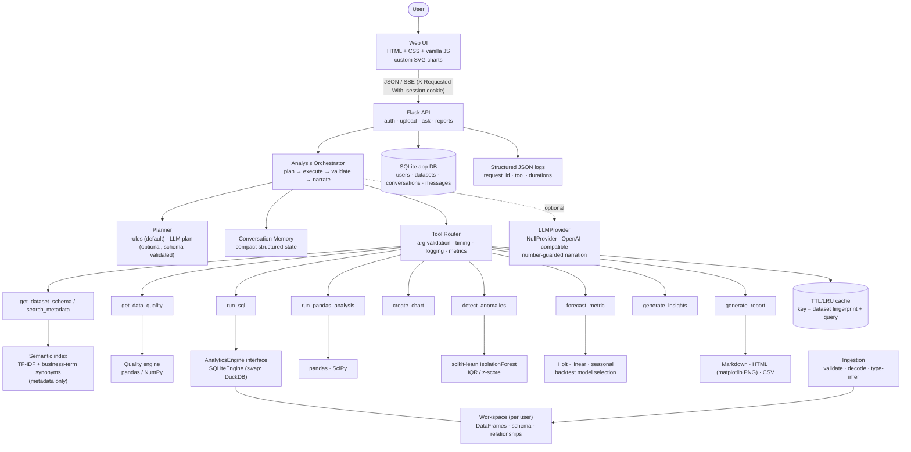
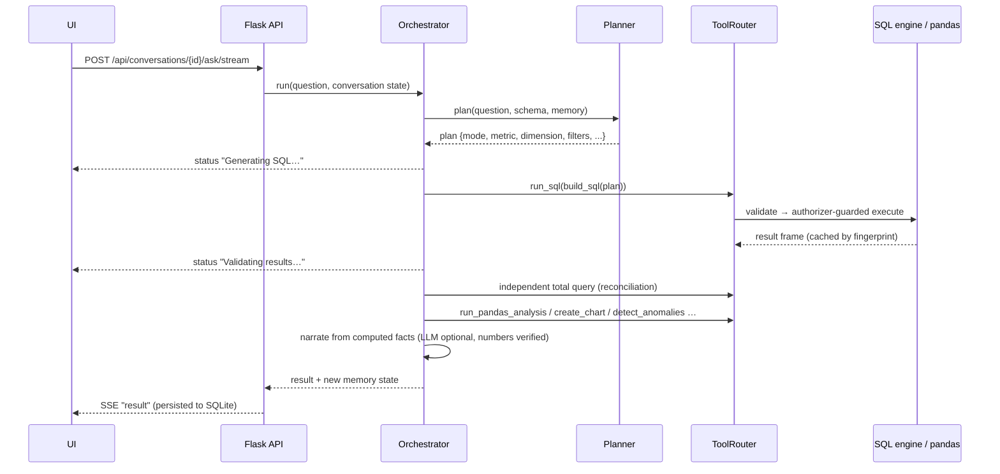

# Architecture

## Component diagram



## Request flow (question → answer)



## Key design decisions

| Decision | Why |
|---|---|
| **Plan-and-execute, not free-form code** | The planner produces a small JSON plan; deterministic builders turn it into SQL. No LLM- or user-authored code is ever executed. |
| **Every number is computed** | SQL, pandas, SciPy, scikit-learn. The narrator formats computed facts; the optional LLM may only rephrase them and its numbers are verified against the facts (`numbers_supported`) or discarded. |
| **Result validation** | Grouped sums are reconciled against an independent total query; shortfalls (e.g. rows with no matching customer) are reported, not hidden. |
| **SQL defence in depth** | static validator (single SELECT/WITH, keyword blocklist) → SQLite *authorizer* (only reads of registered tables) → timeout → row cap. |
| **Swap points** | `AnalyticsEngine` (SQLite→DuckDB), `LLMProvider`, Flask blueprint (→FastAPI), static UI (→React). |
| **Per-user workspace in memory** | Simple and fast for an assessment; files persist on disk and are reloaded lazily after restart. |
| **Cache key = dataset fingerprint + normalised query** | Uploading/removing data changes the fingerprint, so stale results are never served. |

## Module map

```
app/
  __init__.py          app factory, security headers, error handlers, request logging
  config.py            env/.env configuration (secrets excluded from repr)
  api/routes.py        HTTP endpoints (auth, datasets, ask + SSE, reports, metrics)
  agents/              orchestrator · planner · narrator · memory · llm (provider abstraction)
  tools/               base (Tool, ToolRouter) + one file per tool
  services/            ingestion · profiling · quality · relationships · semantic · sql_engine ·
                       query_builder · codegen · anomaly · forecasting · reporting · overview · registry
  core/                db · cache · logging_setup · security · errors
  static/              index.html · style.css · app.js · charts.js
```
